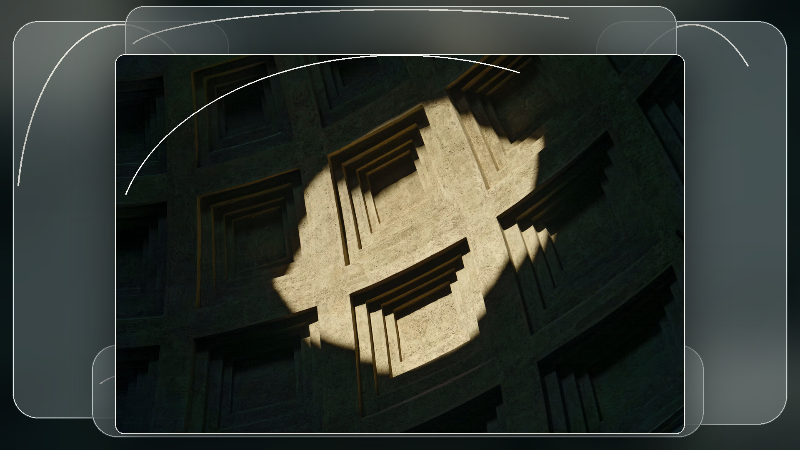
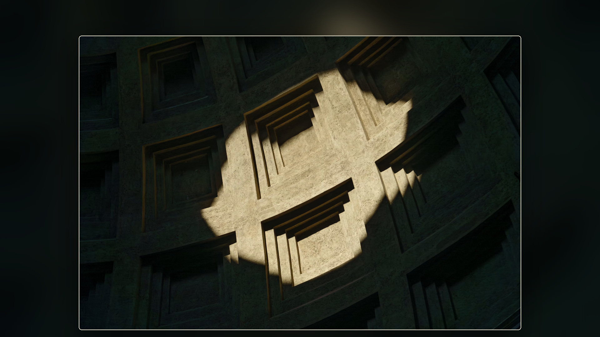
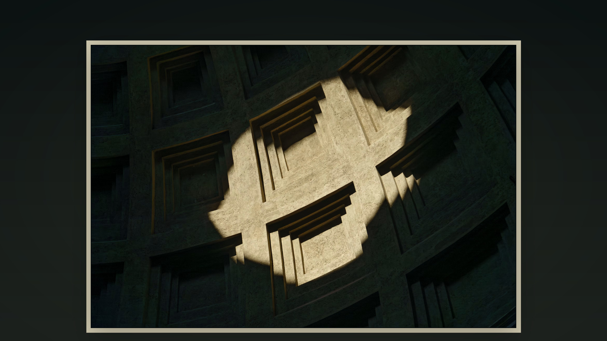
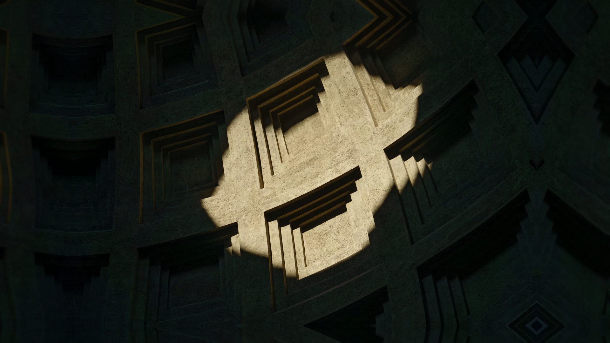

# Photo-to-Wallpaper Rendering Engine

> **기획 / 시각적 실험 단계** · Brave 웹페이지의 첫 화면(Hero Section)을 위한 일관된 사진 배경 이미지 생성 파이프라인

## 1. 프로젝트 개요

목표는 다양한 비율의 사진(세로형·가로형·정방형)을 하나의 일관된 규칙으로 가공하여, **Brave 웹페이지의 화면 전체를 채우는 배경 이미지**로 만드는 것이다. 단순히 16:9로 강제 리사이즈하거나 사진을 크롭하는 도구가 아니다.

핵심 원칙은 다음과 같다.

- **원본의 보존:** 사진의 주요 피사체·구도·분위기를 가능하면 손상하지 않는다.
- **여백의 디자인:** 부족한 공간을 블러, 반투명 유리, 갤러리 매트, 구조적 확장 등으로 처리한다.
- **출력 규칙의 일관성:** 원본 비율이 다르더라도 최종 배경은 표준화된 비율과 해상도로 출력한다.
- **실험 우선:** 시각적 결과를 먼저 비교하고 *안이 확정되면* 기술 스택과 자동화를 결정한다.
- **로컬 워크플로:** Apple Silicon(M5)에서 실행 가능한 오픈소스 기반 CLI와 Bash wrapper를 지향한다.

```text
사진 입력 (세로 / 가로 / 정방형)
             ↓
이미지 분석 및 구도 결정
             ↓
확장 스타일 적용 (A / B / C / D)
             ↓
규격화된 Wallpaper 출력
             ↓
Brave 웹 배경 / Hero Section
```

## 2. 네 가지 디자인 시안

동일한 원본 사진으로 구성된 **1920 × 1080px, 16:9 비교 시안**이다. 상대경로 링크를 사용하므로 이 Markdown과 JPG 파일들을 같은 폴더에 두면 그대로 참조할 수 있다.

### A안 — Liquid Glass 확장



[원본 JPG 열기 — exmpl_a_Expand-liquid-glass.jpg](./exmpl_a_Expand-liquid-glass.jpg)

원본 사진 주변에 iOS의 반투명 유리 같은 **블러·광택·유리 경계·은은한 굴절감**으로 공간을 생성한다. 시각적 개성이 뚜렷하고 프로젝트에서 가장 우선적으로 실험할 방향이다. 실제 구현 시 Gaussian Blur만으로 끝내지 않고 다층 블러, 굴절, 투명도, 경계 하이라이트를 조절할 수 있어야 한다.

### B안 — 원본 기반 Blur 확장



[원본 JPG 열기 — exmpl_b_Expand-blur.jpg](./exmpl_b_Expand-blur.jpg)

원본 이미지를 확대하여 흐릿한 배경으로 사용하고, 중앙의 원본은 선명하게 유지한다. **원본의 시각적 연속성**을 유지하면서도 비교적 단순하고 빠르게 처리할 수 있다. 다만 사진 주변의 블러가 다소 일반적인 영상 배경처럼 보일 수 있다.

### C안 — 갤러리형 여백 확장



[원본 JPG 열기 — exmpl_c_Expand-galery.jpg](./exmpl_c_Expand-galery.jpg)

원본 사진의 주변을 어두운 매트 색상 또는 원본에서 추출한 대표 색으로 채워 **전시관·사진 갤러리 같은 여백**을 만든다. 사진 내용의 보존이 쉽고 정돈된 결과를 얻을 수 있다. 대신 전체 화면을 하나의 사진처럼 연결하는 방식은 아니다.

### D안 — Content-aware / 생성형 확장



[원본 JPG 열기 — exmpl_d_Expand-generation.jpg](./exmpl_d_Expand-generation.jpg)

사진의 건축적 구조와 질감을 분석하여 사진 바깥 공간까지 자연스럽게 이어지는 화면을 지향한다. 가장 몰입감 있는 결과를 기대할 수 있지만 **원본에 없던 시각 정보를 생성**할 수 있으므로 결과의 충실도와 품질 검증이 필요하다.

> **시안의 범위:** A안은 로컬 이미지 합성으로 만든 *Liquid Glass 지향* 개념 시안이며 Apple의 실제 시스템 렌더러를 구현한 것이 아니다. D안 또한 실제 AI 생성형 아웃페인팅이 아니라 **반사·변형된 이미지 구조로 확장을 모사한 개념 시안**이다. 따라서 향후 생성형 모델 기반 결과와 반드시 따로 비교해야 한다. 네 이미지 모두 최종 디자인 확정본이 아니다.

## 3. 기술적인 접근 (후보)

기술 스택은 시각적 방향을 확정한 후 선택한다. 다음은 오픈소스 중심의 검토 후보이다.

| 작업 단계 | 검토 후보 | 비고 |
| --- | --- | --- |
| 사진 정보 분석 | Python, Pillow, OpenCV | 원본 크기·방향·구도 분석 |
| 유리/블러 스타일 구현 | Core Image, Metal Shaders | Apple 가속 활용 가능; 오픈소스 대안·구현 방식 검토 필요 |
| 이미지 합성 및 인코딩 | libvips, ImageMagick | 대량 파일 처리, WebP/JPEG 출력 |
| 고급 구조 확장 | PyTorch + MPS 지원 모델 | 생성형 아웃페인팅은 모델별 지원/품질 확인 |
| 일괄 처리 | Python CLI, Bash wrapper | 설정 기반 순차 실행, 오류 처리 및 기록 |

성능 목표 플랫폼은 **Apple M5 Silicon**이다. 실제 워크로드에서 CPU·GPU·메모리 사용량을 측정한 뒤, GPU 가속이 유익한 작업에만 적용한다.

## 4. 단계별 작업 순서

1. **디자인 프로토타이핑:** 같은 사진으로 A/B/C/D 결과를 비교한다. 특히 세로 사진과 가로 사진 모두 확인한다.
2. **시각적 규칙 확정:** 원본의 최대·최소 점유율, 여백 넓이, 블러·유리 효과 강도, 배치, 안전 영역을 결정한다.
3. **로컬 CLI 개발:** 확정된 스타일을 재현할 수 있도록 옵션과 프리셋을 제공하는 재사용 가능한 도구를 만든다.
4. **Bash wrapper 구축:** 입력 폴더 순회 → 메타데이터 분석 → 렌더링 → 검증 → 출력 및 로그 기록을 자동화한다.

## 5. 출력 비율과 배경 적용의 구분

**출력 이미지의 가로·세로 비율을 통일하는 것**과 **원본 사진의 비율과 내용을 보존하는 것**은 서로 다르다.

예를 들어 세로 사진도 16:9 파일에 담을 수 있다. 이때 원본을 늘리거나 억지로 잘라내지 않고, 좌우에 새로운 여백 디자인을 적용하면 된다.

권장할 초기 실험 규격은 다음과 같다.

- **실험 출력:** 1920 × 1080px (16:9)
- **고해상도 출력 후보:** 2560 × 1440px (16:9)
- **필요한 추가 실험:** 21:9 초광폭, 9:16 모바일 화면
- **검증 사항:** 실제 Brave 표시 방식에서 발생할 수 있는 `cover` 크롭, 시각적 안전 영역, 압축 화질 및 파일 크기

브라우저의 배경 표시가 `cover`에 가까울 경우 화면 비율에 따라 **이미지 가장자리가 잘릴 수 있으므로**, 원본의 핵심 피사체와 중요한 요소를 안전 영역 안에 배치하는 것이 필요하다.

## 6. 평가 기준 및 다음 결정

시안 확정 전 동일한 원본 여러 장에 대해 아래 기준을 비교한다.

| 기준 | 확인할 내용 |
| --- | --- |
| 원본 보존 | 피사체·구도·콘트라스트가 손상되지 않는가? |
| 디자인 일관성 | 서로 다른 사진에서도 같은 시각 언어가 유지되는가? |
| 세로 사진 대응 | 좌우 여백이 의도적으로 디자인된 것처럼 보이는가? |
| 화면 대응 | 일반 모니터와 초광폭 화면에서 핵심 요소가 잘리지 않는가? |
| 자동화 적합성 | 파라미터를 수치화하고 배치 처리할 수 있는가? |
| 실행 효율 | M5 환경에서 시간·메모리·결과 용량이 합리적인가? |

**현재 단계의 결론:** 특정 프레임워크나 모델을 먼저 채택하기보다, 사진을 실제로 변환한 A/B/C/D 시안을 비교하고 시각적 기준을 확정한다. 선택된 안을 기준으로 **Photo-to-Wallpaper Rendering Engine**을 구현한다.

---

### 파일 구성

```text
Photo-to-Wallpaper-Rendering-Engine/
├── README.md
├── exmpl_a_Expand-liquid-glass.jpg
├── exmpl_b_Expand-blur.jpg
├── exmpl_c_Expand-galery.jpg
└── exmpl_d_Expand-generation.jpg
```

*최초 예제의 원본 사진 크기: 2047 × 1365px (약 3:2). 시안용 JPG 출력: 1920 × 1080px (16:9).*
